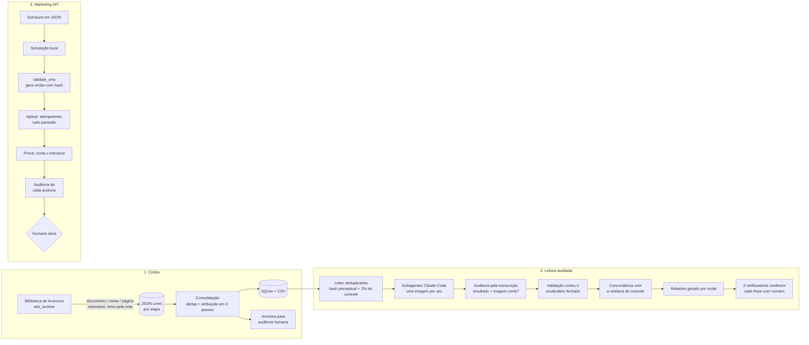

# Anúncios da Meta com IA: coleta, leitura auditada de criativos e automação de campanhas

> **English summary.** A media-intelligence pipeline for Meta ads with three parts: (1) a resumable collector for the official Ad Library API (`ads_archive`) with quota-aware throttling, deduplication and rule-based attribution of each ad to its advertiser; (2) LLM classification at scale, where Claude Code subagents read images and captions against a closed vocabulary under an audited protocol (one image at a time, transcript-based alignment audit, independent re-reading of a control sample, three-verifier consensus, script-generated report); (3) idempotent Marketing API automation with mandatory `validate_only`, resume after failures, usage-header throttling and a post-upload audit of every ad. In production it handled ~40k ads from ~290 advertisers and ~17k distinct creatives read by subagents. Runs offline with synthetic data via `python demo.py`.

## O problema

Num mercado com centenas de anunciantes, a pergunta "quem está anunciando o quê, para quem e com quanto dinheiro" tem resposta pública: a Biblioteca de Anúncios da Meta. Na prática, três obstáculos impedem de usá-la em escala:

1. **A busca é ruidosa.** A API procura por palavras soltas: buscar o nome de uma organização devolve qualquer anúncio que tenha uma daquelas palavras. Numa coleta de teste com 35 anunciantes, 4.709 dos 4.948 anúncios devolvidos eram de terceiros. Sem atribuição rigorosa, qualquer contagem vira ficção.
2. **O conteúdo está nas imagens.** O assunto de um anúncio muitas vezes só aparece na arte: o texto da legenda é curto ou genérico. Ler milhares de criativos à mão não cabe no prazo; mandar um modelo ler sem controle produz erro que ninguém vê.
3. **Executar campanhas por script é rápido, inclusive para errar.** Uma estrutura com uma centena de conjuntos criada pela interface leva horas; por script leva minutos, e um erro de configuração se replica em todos os anúncios no mesmo tempo.

## A solução

Um pipeline em três partes, cada uma com seus controles:

| Parte | O que faz | Controle principal |
|---|---|---|
| **1. Coleta** (`coleta/`) | Coletor retomável da API oficial, por documento, nome e página do anunciante; consolida em SQLite e CSV | Atribuição por sinais em ordem de força, travas contra homônimos, amostra para auditoria independente |
| **2. Leitura com LLM** (`classificacao/`) | Subagentes do Claude Code leem imagem e legenda e classificam com vocabulário fechado | Protocolo um a um + auditoria pela transcrição, validação de vocabulário, releitura de controle, consenso de 3 verificadores |
| **3. Marketing API** (`marketing_api/`) | Cria campanhas, conjuntos e anúncios a partir de um JSON | `validate_only` obrigatório com recibo, idempotência por nome, prova conta x estrutura, auditoria de cada anúncio |

## Arquitetura



## Técnicas de IA e engenharia

### 1. Coleta e atribuição

- **Cliente da API com ritmo controlado pela própria Meta** (`coleta/biblioteca.py`). Cada resposta traz o cabeçalho `x-business-use-case-usage` com a ocupação da cota; o cliente desacelera antes do bloqueio (que, quando acontece, dura horas), pausa no teto configurável, reduz o tamanho da página em erro 500 transitório e trata token expirado sem insistir.
- **Coleta retomável por etapa** (`coleta/coletar.py`). Cada etapa grava o estado por entidade em JSON Lines; interromper e rodar de novo pula o que já foi feito. Busca pelo documento do pagador (que a API também procura no rodapé "pago por"), busca leve pelo nome como rede de segurança e, por fim, download completo das páginas que já veicularam anúncio confirmado.
- **Deduplicação com versão mais nova vencendo** (`coleta/consolidar.py`). O mesmo anúncio chega por várias buscas e por atualizações posteriores (com faixas de gasto maiores, porque continuou no ar). A consolidação lê os arquivos em ordem e guarda a última versão.
- **Atribuição por sinais em ordem de força** (`coleta/atribuicao.py`): documento no rodapé; documento no texto; nome completo no rodapé **terminando ali** (sem essa trava, "Costa Alimentos" casaria com "Costa Alimentos do Norte"); nome curto abrindo o rodapé; resultado da busca pelo documento; e, por último, a página já confirmada, desde que o rodapé se pareça com a entidade. Vínculo por nome só vale se a maior parte da entrega foi na região-alvo (descarta homônimo de outra região). Anúncio na página da entidade mas pago por outro fica fora dos totais e numa tabela própria.
- **Gasto honesto sobre faixas.** A Meta publica gasto e impressões só em faixas. Pisos e tetos são somados separadamente; o ponto médio da faixa mais baixa infla quem faz muitos anúncios pequenos, então nessa faixa o gasto é estimado por impressões x CPM de referência medido nos anúncios maiores, limitado à própria faixa.
- O `ad_snapshot_url` da API vem com o token embutido: o cliente troca pelo link público antes de gravar qualquer coisa em disco.

### 2. Classificação com LLM em lote auditado

- **Vocabulário fechado como contrato** (`exemplos/vocabularios/*.json`, `classificacao/vocabulario.py`). O mesmo arquivo diz ao modelo o que marcar e diz ao script o que aceitar. Código fora da lista não derruba o lote: vira `outro` e o termo vai para revisão, o que mostra onde o vocabulário precisa crescer.
- **Lê-se cada coisa uma vez** (`classificacao/montar_lotes.py`). A mesma arte roda em dezenas de variações de anúncio; imagens quase iguais (recodificadas, redimensionadas) são agrupadas por hash perceptual de 256 bits com limiar de distância, e textos por hash do texto normalizado. As mais vistas entram primeiro, para que um corte de orçamento no meio ainda cubra o que mais pesa.
- **Orquestração com Claude Code** (`classificacao/workflows/ler_lotes.js`). Um subagente por lote, em ondas paralelas, pela ferramenta Workflow. O protocolo é estrito: abrir **uma** imagem, gravar o resultado dela num arquivo com o **nome da imagem aberta**, só então abrir a próxima. Toda mensagem do leitor é uma chamada de ferramenta (mensagem só de texto encerra o subagente e perde o lote). Lotes grandes são divididos entre leitores por faixa de itens.
- **Auditoria de alinhamento pela transcrição** (`classificacao/auditar_alinhamento.py`). A falha que nenhum validador de formato pega: o leitor abre duas imagens parecidas seguidas e grava o resultado de uma com o conteúdo da outra. O auditor percorre o registro de ferramentas de cada subagente e confere, para cada gravação, qual foi a última imagem aberta antes dela; resultado desalinhado é apagado e o lote volta para a fila. Os vereditos ficam num registro, então as transcrições (centenas de KB por imagem) podem ser apagadas.
- **Validação e consolidação** (`classificacao/validar_lotes.py`): todo item do manifesto precisa ter resultado; JSON quebrado ou item faltando devolve o lote; o campo `arquivo` dentro do JSON tem de bater com o nome do arquivo.
- **Releitura de controle** (`classificacao/concordancia.py`): cerca de 2% dos itens são lidos de novo por outro subagente, sem ver a primeira leitura. Mede-se F1 das palavras transcritas e Jaccard dos códigos; os piores casos vão para revisão humana.
- **Consenso de três verificadores** (`classificacao/consenso.py`, `workflows/verificar_tres.js`). Para classificações sensíveis, três verificadores independentes votam; sem maioria, a decisão é humana. Para o relatório, cada frase com número é separada (`frases_para_conferir.py`) e recalculada contra o SQLite por três verificadores que não escreveram o texto; qualquer divergência vai para revisão com a consulta usada por cada um.
- **Relatório sem número digitado** (`classificacao/relatorio.py`): tudo sai da base e dos arquivos de controle.

### 3. Automação da Marketing API

- **`validate_only` obrigatório** (`marketing_api/subir_estrutura.py`). `--validar` chama a API com `execution_options=validate_only` e grava um recibo com o hash SHA-256 do arquivo de estrutura. `--aplicar` se recusa a rodar se não houver, para exatamente aquele arquivo, um recibo de validação sem erro. Conjunto que não pôde ser validado antes (a conta ainda não tinha campanha daquele objetivo) passa por `validate_only` logo antes de ser criado.
- **Idempotência por nome.** Antes de criar, o script lê campanhas, conjuntos e anúncios existentes e junta com o registro local; o que existe é pulado. POST que cai por rede não é repetido às cegas: o script procura o objeto pelo nome primeiro, porque a Meta pode ter gravado antes de a conexão cair.
- **Ritmo pelo cabeçalho de uso** e **lote** (`marketing_api/cliente.py`): espaçamento proporcional à ocupação da cota, espera exata quando a Meta informa o tempo de recuperação, endpoint batch (até 50 operações por chamada de cota) com reenvio só dos itens recusados por limite. Registro gravado de forma atômica, com nova tentativa quando o sistema de arquivos segura o arquivo.
- **Falha que se repete vira bloqueio de tipo**: se o mesmo tipo de conjunto falhar três vezes seguidas por parâmetro, o resto daquele tipo é pulado e anotado, em vez de gastar cota repetindo o erro.
- **Prova** (`--prova`): lê a conta e compara cada conjunto com a estrutura (status, verba, otimização, idade, plataformas, número de localizações). Pega edição manual feita depois da subida.
- **Auditoria pós-subida de cada anúncio** (`marketing_api/auditar_anuncios.py`), sem amostragem: botão compatível com o destino do conjunto, link compatível, texto igual ao aprovado, identificação obrigatória presente, nenhum resto de rascunho ("Legenda A:"), código do criativo no nome do anúncio, vídeo sem botão.
- **Nada é ativado por script.** Tudo é criado pausado; ativar é decisão humana depois da auditoria.

## Controles de qualidade e governança

| Risco | Controle | Onde |
|---|---|---|
| Contar anúncio de terceiro | Sinais em ordem de força, trava de fim de nome, filtro de região, regra de pagador | `coleta/atribuicao.py`, `coleta/consolidar.py` |
| Regra de atribuição errada | Amostra por tipo de vínculo para leitor independente, antes de qualquer número | `coleta/amostra_auditoria.py` |
| Modelo gravar resultado da imagem errada | Protocolo um a um + auditoria pela transcrição | `workflows/ler_lotes.js`, `auditar_alinhamento.py` |
| Modelo inventar categoria | Vocabulário fechado, código fora vira `outro` para revisão | `vocabulario.py`, `validar_lotes.py` |
| Leitura ruidosa | Releitura independente de ~2% e métricas de concordância | `concordancia.py` |
| Classificação sensível | Três verificadores, maioria, revisão humana sem maioria | `consenso.py`, `verificar_tres.js` |
| Número errado no relatório | Cada frase com número recalculada por três verificadores contra a base | `frases_para_conferir.py`, `verificar_tres.js` |
| Subir estrutura não testada | Recibo de `validate_only` amarrado ao hash do arquivo | `subir_estrutura.py --validar` |
| Duplicar objeto após falha de rede | Busca por nome antes de repetir POST | `subir_estrutura.py` |
| Divergência entre plano e conta | Prova conta x estrutura | `subir_estrutura.py --prova` |
| Anúncio com erro replicado | Auditoria de cada anúncio, ativação humana | `auditar_anuncios.py` |
| Vazamento de credencial | Só variáveis de ambiente; token removido do `ad_snapshot_url`; IDs como marcadores na estrutura | `.env.example`, `biblioteca.limpar()` |

## Como rodar

Requisitos: Python 3.10+ (só biblioteca padrão) e Pillow para o hash perceptual e as imagens de exemplo (`pip install -r requirements.txt`). Os workflows `.js` rodam na ferramenta Workflow do Claude Code.

**Demonstração offline, sem token** (dados sintéticos de `exemplos/`):

```bash
python demo.py
```

Mostra, em sequência: deduplicação entre arquivos de coleta, atribuição por vínculo, descarte de homônimo e de anúncio pago por terceiro, agregação por entidade; montagem de lotes com imagens deduplicadas, uma onda de leitura simulada com um erro de alinhamento proposital que a auditoria pega e devolve à fila, validação de vocabulário, concordância, consenso e relatório; e, numa conta simulada, a recusa de aplicar sem validar, a recuperação de uma queda de rede sem duplicar, a idempotência na segunda execução, a prova pegando uma edição manual e a auditoria apontando os anúncios fora das regras. Saídas em `saida_demo/`.

**Com a API de verdade** (copie `.env.example`, preencha e exporte as variáveis):

```bash
# 1. Coleta (retomável; rode um processo por vez)
python -m coleta.coletar documento --entidades entidades.csv --saida dados/coleta --data-min 2026-01-01
python -m coleta.coletar nome      --entidades entidades.csv --saida dados/coleta --data-min 2026-01-01
python -m coleta.coletar pagina    --entidades entidades.csv --saida dados/coleta --data-min 2026-01-01
python -m coleta.consolidar --entidades entidades.csv --coleta dados/coleta --saida dados/banco --regiao-alvo "<região>"
python -m coleta.amostra_auditoria --banco dados/banco/base_anuncios.sqlite --saida amostra.md

# 2. Leitura (os lotes são lidos pelo workflow classificacao/workflows/ler_lotes.js no Claude Code)
python -m classificacao.montar_lotes --manifesto itens.jsonl --trabalho dados/leitura
python -m classificacao.auditar_alinhamento --trabalho dados/leitura --transcricoes "<pasta das transcrições>/*/agent-*.jsonl" --aplicar
python -m classificacao.validar_lotes --trabalho dados/leitura --vocabulario exemplos/vocabularios/politicas_publicas.json
python -m classificacao.concordancia --trabalho dados/leitura --vocabulario exemplos/vocabularios/politicas_publicas.json
python -m classificacao.relatorio --banco dados/banco/base_anuncios.sqlite --trabalho dados/leitura --vocabulario <vocabulário> --saida relatorio.md

# 3. Marketing API
python -m marketing_api.subir_estrutura --estrutura exemplos/estrutura_exemplo.json            # simulação local
python -m marketing_api.subir_estrutura --estrutura exemplos/estrutura_exemplo.json --validar
python -m marketing_api.subir_estrutura --estrutura exemplos/estrutura_exemplo.json --aplicar
python -m marketing_api.subir_estrutura --estrutura exemplos/estrutura_exemplo.json --prova
python -m marketing_api.auditar_anuncios --estrutura exemplos/estrutura_exemplo.json --regras exemplos/regras_auditoria.json
```

A Biblioteca de Anúncios exige token com escopo `ads_read` e identidade verificada na Meta. No Brasil, a API devolve a categoria de anúncios sobre temas sociais, eleições ou política; na União Europeia, todos os anúncios.

## Resultados em uso real

Números de uma aplicação real do pipeline, num mercado com centenas de anunciantes:

- **Coleta:** cerca de **40 mil anúncios** de cerca de **290 anunciantes**, deduplicados, atribuídos e consolidados numa base relacional, com todas as etapas de coleta retomáveis.
- **Leitura:** cerca de **17 mil imagens distintas** lidas por subagentes, além de 100% das legendas distintas; releitura de controle de 1,9% das imagens e 2,1% das legendas.
- **Concordância na releitura de controle** (330 imagens comparadas): F1 médio de 0,931 nas palavras transcritas (mediana 1,0; 83,3% das imagens com F1 de 0,9 ou mais); Jaccard médio de 0,758 nos temas; tom igual em 75,2% das imagens e 73,6% das legendas.
- **Auditoria de alinhamento:** mais de 15 mil gravações de resultado de imagem conferidas pela transcrição dos subagentes antes de entrar na base.
- **Marketing API:** estrutura de **109 conjuntos** aplicada por script (57 criados e 52 reconfigurados), no fluxo validar com `validate_only`, aplicar e provar conta x estrutura.

A concordância de temas (Jaccard 0,76) é menor que a de transcrição (F1 0,93): transcrever é mais objetivo que decidir o assunto central. Por isso as classificações que viram conclusão passam pelo consenso de três verificadores.

## Limitações

- Gasto e impressões da Biblioteca são faixas; qualquer total é um intervalo (piso a teto) ou uma estimativa declarada.
- As regras de atribuição dependem do formato do rodapé "pago por" e de um documento do pagador; outro mercado pede ajuste da configuração (`CONFIG_PADRAO` em `atribuicao.py`).
- O limiar do hash perceptual foi calibrado em artes com texto; fotos muito parecidas de anúncios diferentes podem precisar de limiar menor.
- A auditoria de alinhamento depende do formato das transcrições dos subagentes do Claude Code.
- A demonstração simula a onda de leitura (não chama modelo); os workflows rodam no Claude Code.
- A amostra de controle mede ruído entre leitores, não acerto absoluto; a revisão humana dos piores casos continua necessária.

## O que isso mostra para uma empresa

O padrão é o mesmo em qualquer operação que precise **ler muito material não estruturado e decidir com segurança**:

- **Atendimento:** triagem de tickets com vocabulário fechado de categoria e urgência (`exemplos/vocabularios/tickets_suporte.json`), print anexado lido como imagem, consenso de três verificadores para casos de risco (menção a órgão de defesa do consumidor, ameaça de cancelamento).
- **Backoffice e financeiro:** notas fiscais e recibos digitalizados (`notas_fiscais.json`): o modelo transcreve e classifica o centro de custo; somas e conferência de totais ficam no script; alertas viram fila humana.
- **Marketing e produto:** avaliações de clientes por aspecto e sentimento (`avaliacoes_clientes.json`) e auditoria de criativos de varejo (`varejo_servicos.json`), inclusive dos concorrentes, pela Biblioteca de Anúncios.
- **Dados:** coleta retomável de API com cota, deduplicação, regras de atribuição auditáveis e base relacional pronta para análise.
- **Operações em plataformas de terceiros:** qualquer escrita em massa (anúncios, CRM, ERP) com simulação, validação obrigatória amarrada à versão do plano, idempotência, prova depois e ativação humana.

Trocar de domínio é trocar o arquivo de vocabulário e o manifesto de itens; protocolo de leitura, auditoria, concordância, consenso e relatório continuam iguais.

## Estrutura do repositório

```
coleta/            cliente da Biblioteca, coletor retomável, atribuição, consolidação, amostra de auditoria
classificacao/     lotes, auditoria de alinhamento, validação, concordância, consenso, relatório
  workflows/       orquestração dos subagentes no Claude Code (ler_lotes.js, verificar_tres.js)
marketing_api/     cliente com ritmo e lote, subida idempotente, conta simulada, auditoria de anúncios
exemplos/          dados sintéticos: entidades, coleta, imagens, leituras simuladas, vocabulários, estrutura
demo.py            demonstração offline das três partes
```

## Licença

MIT. Ver `LICENSE`.
